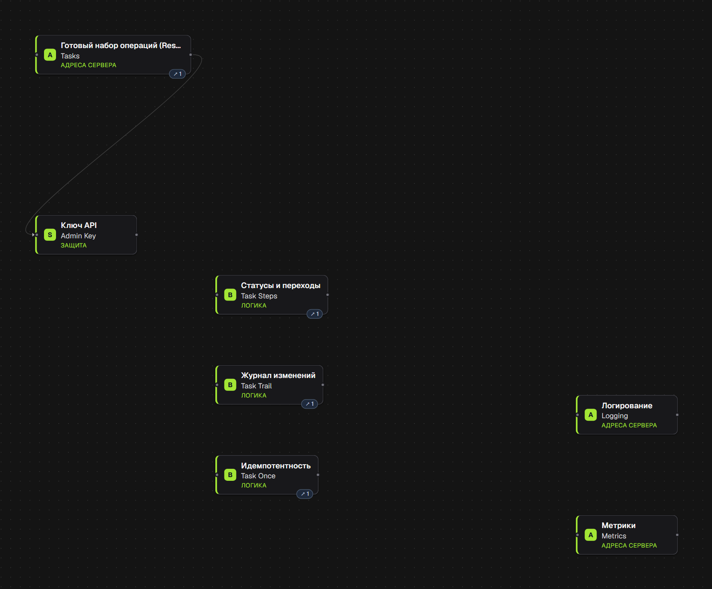

# Tasks API

Образец проекта, сгенерированного в FxM Engine. Код после генерации не правился; из репозитория удалён один устаревший тест прежнего генератора (он не подходит к сервису с логикой, см. ниже). Репозиторий нужен, чтобы оценить код до регистрации и оплаты.

> Собрано в [FxM Engine](https://engine.fxm-int.space). В «Новом проекте» есть галерея из 27 готовых заготовок: сайты, магазины, запись и бронирование, боты, системы для бизнеса. Из любой можно начать свой проект и забрать код в Git.

**Что внутри:** NestJS + Prisma + PostgreSQL. Один ресурс Tasks (название, статус, приоритет, срок, дата создания): список, чтение, создание, изменение, удаление; защита ключом API, Swagger, Docker. Правила в блоках, а не в коде:

- Проверка полей: название от 3 до 120 символов, приоритет от 1 до 5 (иначе отказ).
- Статусы: `todo → doing → done`, из `done` вернуться нельзя (409); каждый переход пишется в историю (`GET /task-status-logs`).
- Журнал изменений (`GET /task-audit-logs`) и защита от повтора создания заголовком `Idempotency-Key`.
- Готовые фильтры списка: `GET /tasks?query=open` (невыполненные по приоритету), `doing`, `done` (последние 20).
- Журнал запросов: сервер пишет по строке JSON на каждый запрос в стандартный вывод (`LOG_LEVEL` задаёт уровень).
- Метрики запросов на `/metrics` (нужен `METRICS_TOKEN`).

**Что проверено**

- `cd backend && npm install && npm test`: 17 тестов, все проходят, база данных не нужна: разбор параметров списка, тесты истории статусов, журнала, идемпотентности и самих переходов, которые генератор пишет к блокам логики.
- **На настоящей базе** (PostgreSQL 16 в Docker, собранный сервер, 12 проверок скриптом по HTTP; скрипта в репозитории нет, в CI он не запускается): запрос без ключа отказан, короткое название и приоритет 9 отказаны, задача создаётся со статусом `todo`, фильтр `open` отдаёт задачи по приоритету, `todo → doing → done` проходит, `done → todo` отвечает 409, история и журнал ведутся, повтор с тем же `Idempotency-Key` возвращает ту же задачу, в журнале запросов по строке на запрос.
- GitHub Actions (`.github/workflows/build-pipeline.yml`) собирает и тестирует проект на каждый push в `main`.

**Чего здесь нет (честно)**

- Тестов с настоящей базой данных и HTTP-слоем в репозитории нет: проверка выше сделана вручную.
- У сервиса задач (правила, статусы, журналы) нет модульного теста на правила полей: генератор пишет такой тест только сервису без других зависимостей. Правила названия и приоритета проверены по HTTP.
- Нет входа пользователей и ролей: доступ по одному общему ключу (`ADMIN_KEY`).
- Нет сайта: это только API.
- Файл `*.hooks.ts` создан пустым: в нём пишется ваш код вокруг вызовов сервиса, и повторная генерация его не перезаписывает.

---

# Заготовка: REST API

Сгенерировано в FxM Engine. Проект можно открыть в любой IDE, положить в Git и развивать дальше без FxM Engine.

## Части проекта

- Сервер
- База данных
- Сборка и выпуск (CI/CD)

## Из каких блоков собрано

Снимок холста сервера Engine, снятый с `project.json` из этого репозитория. Код получен из этих блоков нажатием «Сгенерировать»; правила меняются на холсте, а не в сгенерированных файлах.

- **Готовый набор операций (Resource)** `Tasks` — API задач (список, чтение, создание, изменение, удаление) и **Ключ API** `Admin Key`, который закрывает маршруты записи.
- **Статусы и переходы** (`Task Steps`): `todo → doing → done`, обратно `done → todo` нельзя.
- **Журнал изменений** (`Task Trail`), **Идемпотентность** (`Task Once`: повтор создания с тем же `Idempotency-Key` возвращает ту же задачу).
- **Логирование** и **Метрики**: журнал запросов и `/metrics`.

В базе одна таблица `Task` с полями `id`, `title`, `done`, `status`, `priority`, `dueAt`, `createdAt`.

## Запуск

1. Установите [Docker Desktop](https://www.docker.com/products/docker-desktop/) (бесплатно) и запустите его.
2. Откройте терминал в этой папке.
3. Скопируйте `backend/.env.example` в `backend/.env` и заполните то, что нужно вашему проекту: ключи сервисов, которыми вы пользуетесь (например, ключ провайдера ИИ), и секреты, которые вы придумываете сами (любой длинный случайный текст). Пустые переменные необязательны. Без `backend/.env` проект всё равно запустится, но возможности, которым нужен ключ или секрет, останутся выключены. Исключение — ключи, защищающие ваши маршруты (`ADMIN_KEY`): защищённый маршрут никого не пускает, пока его ключ не станет длинным случайным текстом, который вы придумали сами; вызывающий затем передаёт тот же текст в заголовке `x-api-key`. Веб-страница такой ключ не несёт, поэтому без него сайт показывает и добавляет только то, что в проекте открыто для всех.
4. Выполните `docker compose up --build`. Первый запуск занимает несколько минут.
5. Откройте http://localhost:3000 — там отвечает сервер.
6. Остановить можно `Ctrl+C` в терминале; `docker compose up` запустит всё снова с сохранёнными данными.

## Если что-то не работает

Выполните `docker compose logs`, чтобы увидеть, что пошло не так. Строка вроде `request failed: 401` от подключённого сервиса означает, что его ключ в `backend/.env` не задан или неверен; исправьте его и выполните `docker compose up -d` снова.
